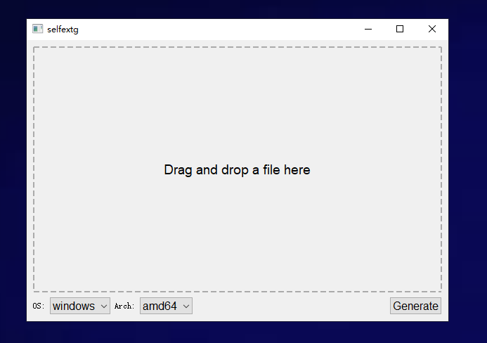

# selfext

Turn an existing archive into a standalone self-extracting executable for Windows,
Linux, or macOS. The recipient does not need Go or an archive utility.

Selfext ships precompiled extractors for eight OS/architecture combinations. It
streams the original archive into the selected executable: **no Go SDK, compiler,
network connection, or runtime dependency downloads are needed when packaging.**



## Install with Go

Requires Go **1.27.3 or newer**:

```sh
go install github.com/gzj/selfext@latest
```

The module includes precompiled extractors for every supported target. No clone,
Make, or resource generation step is required. Rerun the command to update to
the latest release.

To install an unreleased checkout locally:

```sh
go install .
```

Go installs `selfext` (`selfext.exe` on Windows) into `GOBIN` if configured,
otherwise into the `bin` directory under `GOPATH` (normally `$HOME/go/bin`). Add
that directory to your `PATH`. For the default location on Linux/macOS:

```sh
export PATH="$(go env GOPATH)/bin:$PATH"
selfext --version
selfext example.zip
```

Go is only needed for installation, not for subsequent packaging or extraction.
The `@latest` command uses the latest published module version; local changes
become available through it after they are committed, pushed, and released with
a new version tag.

## Usage

```sh
selfext example.zip
selfext --archive example.tar.gz --os windows --arch amd64
selfext example.zip --os darwin --arch arm64 -o example-mac.run
```

The default target is the host OS/architecture. Default output is next to the
archive: `example.zip.exe` for Windows, `example.zip.run` for Linux/macOS. Existing
outputs are never overwritten; use a different `--output` path or remove the old
output yourself. On Unix, generated files are executable.

Run the generated executable to extract into `example/` in the current working
directory, or choose another destination:

```sh
./example.zip.run
./example.zip.run --directory /path/to/destination
```

ZIP, TAR and compressed TAR formats supported by `github.com/mholt/archives` can
be packaged. Support for other formats follows that library's extractors; a
standalone compressed stream such as a `.gz` containing no archive is rejected.
Packaging identifies the format but does not fully extract/test every entry;
unsupported entries or corrupt archive contents fail at extraction time.

Supported targets:

| OS | Architectures |
| --- | --- |
| Windows | 386, amd64, arm64 |
| Linux | 386, amd64, arm64 |
| macOS (`darwin`) | amd64, arm64 |

A generated executable runs on its selected target, not all platforms at once.
The Python/PyQt5 GUI is optional: install PyQt5, put `selfext` on PATH, and run
`python selfextg.py`. It calls the same packager and supports drag and drop.

## Build from source

Development requires Go **1.27.3 or newer**, matching `go.mod`, and Make for the
commands below. The first build may download Go modules through the Go toolchain.
It does not download or embed a separate SDK.

```sh
make build       # build the native packager using the bundled extractors
make test        # unit and extraction security tests
make release     # standalone packagers for all eight host targets in release/
```

Without Make, from the repository root:

```sh
go build -trimpath -o target/ .
```

Precompiled extractors in `internal/stubs/data/*.gz` are version-controlled and
included in Go module releases. `go build`, `go install`, `make build`, and
`make release` all use these bundled resources. `make clean` preserves them.

When changing extractor runtime code (`cmd/stub`, `internal/bundle`,
`internal/codesign`, or `internal/extract`) or its dependencies, regenerate the
extractors and include the updated `.gz` files in the same commit:

```sh
make stubs       # or: go run ./cmd/build-stubs
go test -tags=integration ./...
```

CI tests the checked-in resources without rebuilding them first, so missing or
broken release resources cannot be hidden by a generation step.

For end-to-end checks after `make build`:

```sh
go test -tags=integration ./...
```

These run the native extractor without Go on PATH, test ZIP and tar.gz, validate
all eight output formats, and verify the macOS ARM64 ad-hoc signature hashes.
The GitHub Actions workflow runs these tests on Linux, Windows, and macOS,
including the system `codesign --verify --strict` check on macOS. Local
cross-compilation alone does not prove runtime compatibility.

## How it works

```text
precompiled extractor | original archive | JSON metadata | versioned footer
```

The footer records lengths and a SHA-256 checksum of the archive and metadata.
The extractor opens itself, validates bounds/checksum, and gives a bounded reader
to the archive library. It does not write a temporary copy of the archive or
load the entire archive into memory. The checksum detects corruption, not the
identity of the publisher.

For macOS ARM64, selfext relocates and rebuilds the Go linker's ad-hoc signature
after the footer, including the new payload in the signed range. This works on
all supported packaging hosts without the macOS `codesign` tool. These signed
outputs are limited to less than 4 GiB by Mach-O signature offsets. Ad-hoc signing
is not Developer ID signing or notarization and does not bypass Gatekeeper.
Windows Authenticode signing after packaging is not currently supported by the
footer reader.

## Extraction safety

Only regular files and directories are supported. Unsafe paths, symbolic links,
hard-link entries, special files, and overwriting existing files are rejected.
Filesystem writes are confined with Go's `os.Root`. Existing destination links
cannot redirect extraction outside that root. Extraction can leave previously
written files behind if a later entry fails; it is not a transactional operation.
Only run self-extracting executables from sources you trust.

## Layout

- `selfext.go`: CLI, input validation, output creation.
- `cmd/build-stubs`: release-time cross-compilation and compression.
- `cmd/stub`: standalone extractor entry point.
- `internal/bundle`: container format, checksum, Mach-O signature relocation.
- `internal/extract`: shared confined archive extraction.
- `internal/stubs`: embedded precompiled executables.
- `selfextg.py`: optional PyQt5 GUI.

## License

See [LICENSE](LICENSE). Adapted Go signing code and bundled dependency licenses
are described in [THIRD_PARTY_NOTICES.md](THIRD_PARTY_NOTICES.md).
